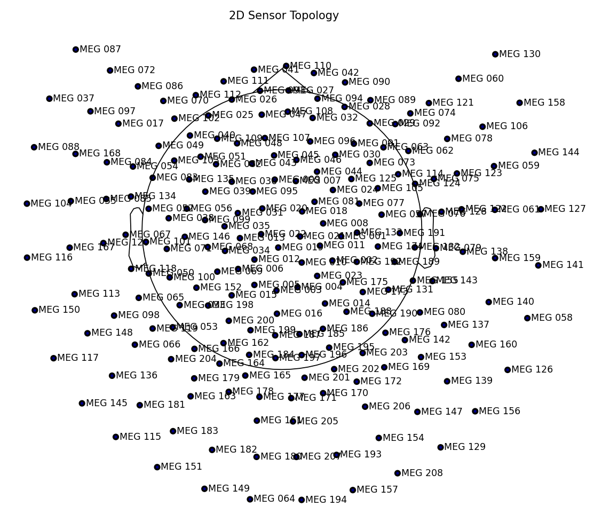

# MEG\_DECODING

---

## Table of Contents

1. [Overview](#overview)
2. [Plot Evoked Responses](#plot-evoked-responses)
3. [Installation](#installation)
4. [Usage](#usage)
5. [Project Structure](#project-structure)
6. [Configuration](#configuration)
7. [Graphs](#graphs)
8. [Remarks](#remarks)
9. [Testing](#testing)
10. [To Do](#to-do)
11. [Sensor Topology](#sensor-topology)
12. [Performance & Status](#performance--status)
13. [Resource Usage](#resource-usage)
14. [Findings](#findings)

---

## Overview

A pipeline for MEG signal decoding using both Neural Networks (NN) and Linear Discriminant Analysis (LDA).

---

## Plot Evoked Responses


## Installation

Install required Python packages:

```bash
pip install -r requirements.txt
```

---

## Usage

1. **Change to project root** (parent directory of `app`).
2. Run main script:

   ```bash
   python -m app.main
   ```

---

## Project Structure

All code lives under the `app` folder:

* **Entry point**

  * `app/main.py`

* **Configuration template**

  * `train_config.json`

* **Models**

  * `app/models/nn/nnModelRunner.py` — setup and run NN experiments
  * `app/models/nn/nnModel.py` — definition of Neural Network
  * `app/models/lda/ldaModelRunner.py` — setup and run LDA experiments
  * `app/models/lda/ldaModel.py` — definition of LDA model

* **Preprocessing**

  * `app/signal/preprocessor.py` — data loading, epoch creation, filtering

---

## Configuration

Supported **target labels**:

* `voiced`
* `word_onset`
* `plot_word_evo`

To plot evoked responses:

```json
{
  "flow": "plot_word_evo",
  "target_label": "plot_word"
}
```

---

## Graphs

* Evoked response of each event:
  [Google Drive Folder](https://drive.google.com/drive/u/0/folders/1ZoWMuvWO3q_cWMu2V3O5MAw7kJiG3BQ-?hl=zh-TW)

---

## Remarks

* All paths (save\_path, file opening, etc.) should be **relative** to the project root (`MEG_DECODING` folder).
* Use small cutoff for `preprocess_low_pass` and larger for `preprocess_high_low`.

---

## Testing

To test custom imports in `app.test_main`:

```bash
cd <project_root>
python -m app.test_main
```

---

## To Do

* Refactor model loading: instantiate model first, then load data batch-by-batch.
* Investigate streaming epochs to reduce memory footprint.

---

## Sensor Topology



---

## Performance & Status

### After Merge

* **NN**: all components are working correctly.
* **SVM**: current error when reshaping tensors:

  ```text
  RuntimeError: shape '[-1, 16848]' is invalid for input of size 15299232
  ```

---

## Resource Usage

* **Batch size**: 2000 subjects
* **Peak memory**: \~87% when loading all sessions and applying baseline & filters
* **Warning**: `concatenate_epochs` loads all data into memory — avoid using it.

---

## Findings

* Frequency band 1–8 Hz with voiced phoneme yields better decoding.
* Consider offsetting onset time by –0.05s.
* Set `decim=1` for 800 time points per epoch, then apply CNN sliding window with average every \~100 samples.
